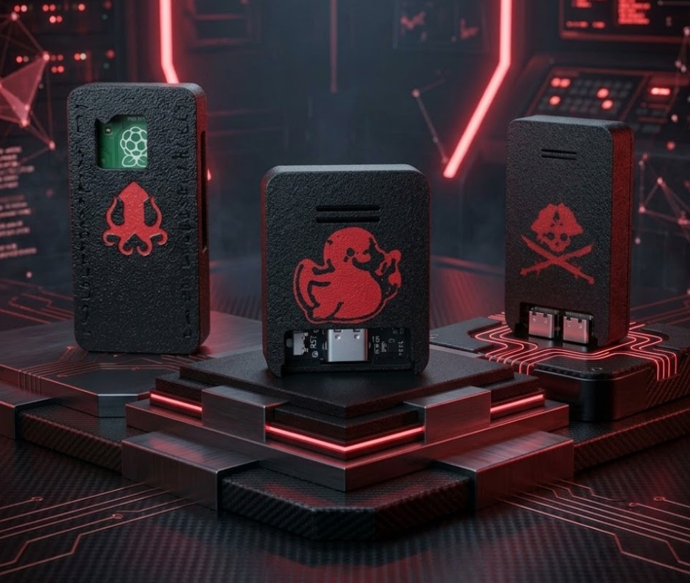

# 🗺️ 7 Seas CTF

**Hardware CTF practice badge — ESP32-S3, five staged flags**

The **7 Seas CTF** is a deliberately-vulnerable hardware capture-the-flag badge from P01yg107 Labs. Five staged flags across real hardware interfaces take you from your first serial console to a working attack chain — a pirate treasure map for learning hardware hacking. It's designed to be solved with the Jolly BUS Pirate.

🛒 **Store:** https://p01ylabs.com  ·  🏷️ **Coming soon**  ·  🚧 *In the lab — coming soon*

> ⚠️ **For education and authorized testing only.** See [docs/SAFETY.md](docs/SAFETY.md).

---

## Specs

| | |
|---|---|
| Board | ESP32-S3 (N16R8) |
| Flags | 5 staged challenges |
| Challenge 1 | UART — find the serial console and listen in |
| Challenge 2 | I²C EEPROM — dump the chip, read the log |
| Challenge 3 | SPI flash — pull the image and search the hold |
| Challenge 4 | GPIO — work out the pin sequence |
| Challenge 5 | WiFi target — board the badge's own web app |
| Solve tool | Jolly BUS Pirate (recommended) |
| Case | 3D-printed PETG-CF, pirate/treasure-map themed |

## Quick start

1. Power the badge over USB.
2. Grab your Jolly BUS Pirate (or any UART/I²C/SPI interface).
3. Start with the UART flag — find the console and read what it's saying.
4. Work the map: UART → I²C → SPI → GPIO → WiFi.
5. Full hints and the flag format ship in docs/USAGE.md at launch.

Full walkthrough: **[docs/SETUP.md](docs/SETUP.md)** · Usage & examples: **[docs/USAGE.md](docs/USAGE.md)** · Problems: **[docs/TROUBLESHOOTING.md](docs/TROUBLESHOOTING.md)**

## Firmware & credits

_This device's firmware/software is built in-house by P01yg107 Labs._

This repo is the product documentation and companion material. Where upstream firmware is
used, please support and star the upstream project; firmware issues belong upstream.

## About P01yg107 Labs

Hand-built hardware for people learning offensive security. Every device is flashed and
bench-tested before it ships.

🌐 https://p01ylabs.com  ·  🐙 https://github.com/p0lygl07

---

© 2026 Joshua Burton (P01yg107 Labs). Documentation and original files licensed under the MIT License (see [LICENSE](LICENSE)).
Any upstream firmware remains the property of its respective authors, under their own licenses.
